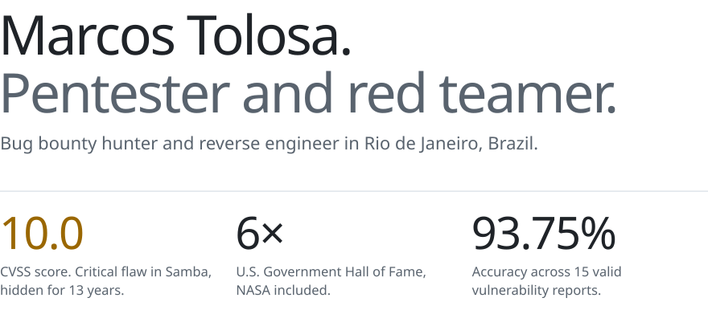

<a href="https://mindsecurity.org">
  <picture>
    <source media="(prefers-color-scheme: dark) and (max-width: 600px)" srcset="./assets/hero-dark-m.svg">
    <source media="(prefers-color-scheme: dark)" srcset="./assets/hero-dark.svg">
    <source media="(max-width: 600px)" srcset="./assets/hero-light-m.svg">
    
  </picture>
</a>

**Pentester (penetration tester), red teamer and bug bounty hunter.** I test web applications, APIs, mobile apps and Active Directory the way real attackers do, and I only report what I can prove.

### Selected work

- **CVE-2025-10230 · Samba · CVSS 10.0.** Critical OS command injection that stayed hidden for 13 years. [Advisory](https://aisle.com/blog/cve-2025-10230-the-cvss-100-vulnerability-that-hid-in-samba-for-13-years)
- **6× U.S. Government Hall of Fame.** NASA, U.S. Dept. of Commerce, Veterans Affairs, NCUA, EPA, Fish & Wildlife Service. Includes a P1 unauthenticated command injection at the [NCUA](https://bugcrowd.com/engagements/ncua-vdp/crowdstream). [Bugcrowd profile](https://bugcrowd.com/h/Tr0p)
- **More disclosures.** [CVE-2026-23722](https://github.com/LabRedesCefetRJ/WeGIA/security/advisories/GHSA-g7hh-6qj7-mcqf) (CVSS 9.1, stored XSS → RCE) and [CVE-2025-67503](https://github.com/LabRedesCefetRJ/WeGIA/security/advisories/GHSA-r9mh-4hc4-h2p3) (CVSS 8.2) in WeGIA · blind XXE → SSRF for the [Belgian Government](https://yeswehack.com/programs/digital-flanders-vulnerability-disclosure-program#program-activity) · [buffer overflow in Samba CTDB](https://gitlab.com/samba-team/samba/-/merge_requests/4240/diffs?commit_id=caa2ac41bf25c524cbe5079a450d87f30a25b0a2).
- **Open-source tools.** [MANW-NG](https://github.com/marcostolosa/manw-ng) (Windows API docs and live execution for reverse engineers) · [OCRack](https://github.com/marcostolosa/OCRack) (PDF OCR and translation) · [ARCTAX](https://github.com/marcostolosa/arctax) (prompt-injection research).

### What I do

Web, API and mobile penetration testing · Red team operations and Active Directory attacks · Bug bounty (Bugcrowd, HackerOne, YesWeHack, Intigriti) · Vulnerability research and exploit development · Reverse engineering and malware analysis · Application security (AppSec) and code review · Cloud security (AWS, Azure, GCP)

**Certifications:** CRTA · CCSP · CKS · OWASP member since 2021.

### Contact

Open to pentest and red team roles and freelance engagements.

[marcos.tolosa@owasp.org](mailto:marcos.tolosa@owasp.org) · [LinkedIn](https://www.linkedin.com/in/marcos-tolosa/) · [mindsecurity.org](https://mindsecurity.org) · [YouTube](https://youtube.com/@Marcos.Tolosa) · [Versão em português](./README.pt-BR.md)
