**disclosures()**

- `10.0` [CVE-2025-10230](https://aisle.com/blog/cve-2025-10230-the-cvss-100-vulnerability-that-hid-in-samba-for-13-years) Samba, OS command injection escondida por 13 anos
- `9.1` [CVE-2026-23722](https://github.com/LabRedesCefetRJ/WeGIA/security/advisories/GHSA-g7hh-6qj7-mcqf) WeGIA, stored XSS → RCE
- `P1` [NCUA VDP](https://bugcrowd.com/engagements/ncua-vdp/crowdstream) Governo dos EUA, OS command injection sem autenticação
- `8.2` [CVE-2025-67503](https://github.com/LabRedesCefetRJ/WeGIA/security/advisories/GHSA-r9mh-4hc4-h2p3) WeGIA, reflected XSS
- `HIGH` [Digital Flanders](https://yeswehack.com/programs/digital-flanders-vulnerability-disclosure-program#program-activity) Governo da Bélgica, blind XXE → SSRF interno
- `MEM` [Samba CTDB](https://gitlab.com/samba-team/samba/-/merge_requests/4240/diffs?commit_id=caa2ac41bf25c524cbe5079a450d87f30a25b0a2) buffer overflow, `sprintf()` inseguro

**tools** · [MANW-NG](https://github.com/marcostolosa/manw-ng) · [OCRack](https://github.com/marcostolosa/OCRack) · [ARCTAX](https://github.com/marcostolosa/arctax) · [REload.Me](https://github.com/mindsecurity/REload.Me)

**hall_of_fame** · NASA · Commerce · Veterans Affairs · NCUA · EPA · Fish & Wildlife · Digital Flanders (BE) → [bugcrowd.com/h/Tr0p](https://bugcrowd.com/h/Tr0p)

<samp><a href="https://mindsecurity.org/pt-br/">mindsecurity.org</a> · <a href="https://mindsecurity.org/pt-br/writeups/">writeups</a> · <a href="https://bugcrowd.com/h/Tr0p">bugcrowd</a> · <a href="https://www.linkedin.com/in/marcos-tolosa/">linkedin</a> · <a href="https://youtube.com/@Marcos.Tolosa">youtube</a> · <a href="https://twitter.com/MarcosTolosa_">x</a> · <a href="mailto:marcos.tolosa@owasp.org">email</a> · <a href="./README.md">english</a></samp>
