<a href="./README.md">English</a> · <a href="https://mindsecurity.org/pt-br/">mindsecurity.org</a> · <a href="https://mindsecurity.org/pt-br/writeups/">writeups</a>

### `disclosures()`

| | ID | Alvo | Classe |
|---:|---|---|---|
| **10.0** | [CVE-2025-10230](https://aisle.com/blog/cve-2025-10230-the-cvss-100-vulnerability-that-hid-in-samba-for-13-years) | Samba | OS command injection, escondida por 13 anos |
| **9.1** | [CVE-2026-23722](https://github.com/LabRedesCefetRJ/WeGIA/security/advisories/GHSA-g7hh-6qj7-mcqf) | WeGIA | stored XSS → RCE / UI redressing |
| **P1** | [NCUA VDP](https://bugcrowd.com/engagements/ncua-vdp/crowdstream) | Governo dos EUA | unauthenticated OS command injection |
| 8.2 | [CVE-2025-67503](https://github.com/LabRedesCefetRJ/WeGIA/security/advisories/GHSA-r9mh-4hc4-h2p3) | WeGIA | reflected XSS |
| High | [Digital Flanders](https://yeswehack.com/programs/digital-flanders-vulnerability-disclosure-program#program-activity) | Governo da Bélgica | blind XXE → internal SSRF (Tomcat Manager) |
| Mem | [Samba CTDB](https://gitlab.com/samba-team/samba/-/merge_requests/4240/diffs?commit_id=caa2ac41bf25c524cbe5079a450d87f30a25b0a2) | Samba | buffer overflow, `sprintf()` inseguro |

### `hall_of_fame()`

NASA · U.S. Dept. of Commerce · Dept. of Veterans Affairs · NCUA · EPA · U.S. Fish & Wildlife Service, mais Digital Flanders (BE).
15 vulns válidas, 93,75% de precisão → [bugcrowd.com/h/Tr0p](https://bugcrowd.com/h/Tr0p)

### `stack`

| | |
|---|---|
| [**MANW-NG**](https://github.com/marcostolosa/manw-ng) | Scraper de docs Win32/NTAPI + engine de execução ctypes ao vivo, pra quem reversa sem sair do terminal |
| [**OCRack**](https://github.com/marcostolosa/OCRack) | Traduz e faz OCR de qualquer PDF mantendo o layout |
| [**ARCTAX**](https://github.com/marcostolosa/arctax) | Gerador de pesquisa em prompt injection com classificador de ML e LLM local |
| [**REload.Me**](https://github.com/mindsecurity/REload.Me) | Um jeito mais simples de aprender engenharia reversa |

`imports` IDA Pro · Ghidra · Rizin · x64dbg · Frida · pwndbg · BloodHound · Impacket · Certipy · Rubeus · Havoc · Cobalt Strike · Burp Suite Pro · pwntools · Semgrep · CodeQL · nuclei · ffuf

### `connect()`

**Tem algo no escopo?** Pentest, red team e pesquisa de segurança → [marcos.tolosa@owasp.org](mailto:marcos.tolosa@owasp.org)

[LinkedIn](https://www.linkedin.com/in/marcos-tolosa/) · [YouTube](https://youtube.com/@Marcos.Tolosa) · [X](https://twitter.com/MarcosTolosa_) · [Discord](https://discord.gg/T9RVG3re2J) · [Bugcrowd](https://bugcrowd.com/h/Tr0p)

`; somente alvos autorizados`
