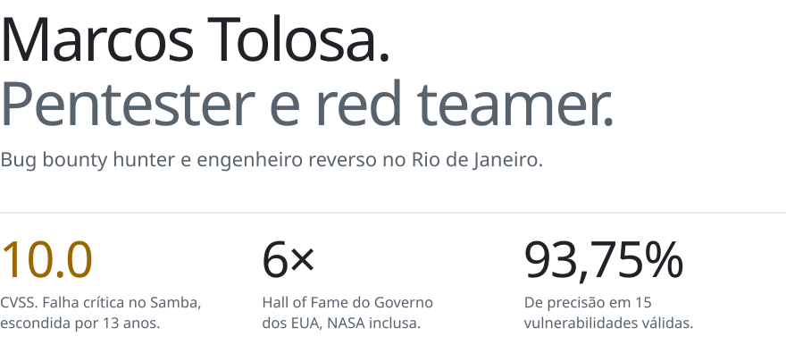

<a href="https://mindsecurity.org/pt-br/">
  <picture>
    <source media="(prefers-color-scheme: dark) and (max-width: 600px)" srcset="./assets/hero-dark-m-pt.svg">
    <source media="(prefers-color-scheme: dark)" srcset="./assets/hero-dark-pt.svg">
    <source media="(max-width: 600px)" srcset="./assets/hero-light-m-pt.svg">
    
  </picture>
</a>

**Pentester (teste de intrusão), red teamer e bug bounty hunter.** Testo aplicações web, APIs, apps mobile e Active Directory do jeito que um atacante real faria, e só reporto o que consigo provar.

### Destaques

- **CVE-2025-10230 · Samba · CVSS 10.0.** OS command injection crítica que ficou escondida por 13 anos. [Advisory](https://aisle.com/blog/cve-2025-10230-the-cvss-100-vulnerability-that-hid-in-samba-for-13-years)
- **6× Hall of Fame do Governo dos EUA.** NASA, Departamento de Comércio, Veterans Affairs, NCUA, EPA e Fish & Wildlife Service. Inclui uma P1 de command injection sem autenticação na [NCUA](https://bugcrowd.com/engagements/ncua-vdp/crowdstream). [Perfil no Bugcrowd](https://bugcrowd.com/h/Tr0p)
- **Outras disclosures.** [CVE-2026-23722](https://github.com/LabRedesCefetRJ/WeGIA/security/advisories/GHSA-g7hh-6qj7-mcqf) (CVSS 9.1, stored XSS → RCE) e [CVE-2025-67503](https://github.com/LabRedesCefetRJ/WeGIA/security/advisories/GHSA-r9mh-4hc4-h2p3) (CVSS 8.2) no WeGIA · blind XXE → SSRF no [Governo da Bélgica](https://yeswehack.com/programs/digital-flanders-vulnerability-disclosure-program#program-activity) · [buffer overflow no Samba CTDB](https://gitlab.com/samba-team/samba/-/merge_requests/4240/diffs?commit_id=caa2ac41bf25c524cbe5079a450d87f30a25b0a2).
- **Ferramentas open source.** [MANW-NG](https://github.com/marcostolosa/manw-ng) (docs e execução da API do Windows para engenharia reversa) · [OCRack](https://github.com/marcostolosa/OCRack) (OCR e tradução de PDFs) · [ARCTAX](https://github.com/marcostolosa/arctax) (pesquisa em prompt injection).

### O que eu faço

Pentest web, API e mobile · Operações de red team e ataques a Active Directory · Bug bounty (Bugcrowd, HackerOne, YesWeHack, Intigriti) · Pesquisa de vulnerabilidades e desenvolvimento de exploits · Engenharia reversa e análise de malware · Segurança de aplicações (AppSec) e code review · Segurança em cloud (AWS, Azure, GCP)

**Certificações:** CRTA · CCSP · CKS · Membro da OWASP desde 2021.

### Contato

Aberto a vagas de pentest e red team e a projetos freelance.

[marcos.tolosa@owasp.org](mailto:marcos.tolosa@owasp.org) · [LinkedIn](https://www.linkedin.com/in/marcos-tolosa/) · [mindsecurity.org](https://mindsecurity.org/pt-br/) · [YouTube](https://youtube.com/@Marcos.Tolosa) · [English version](./README.md)
